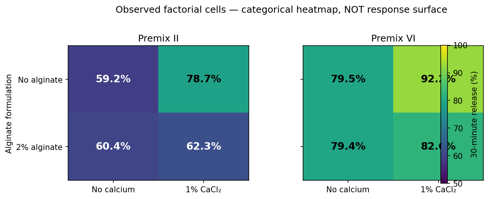
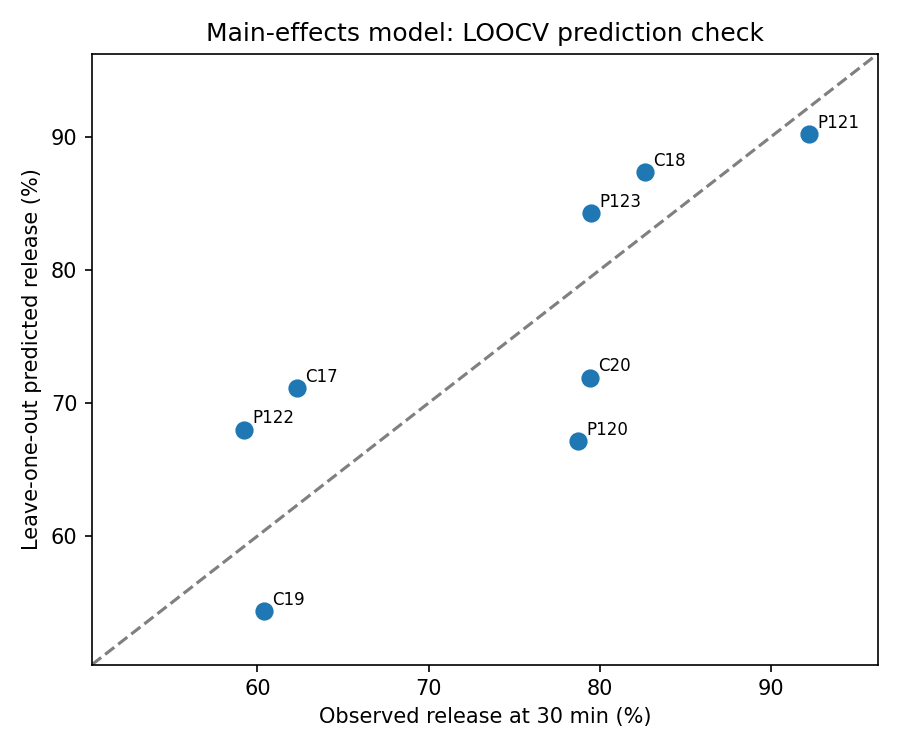
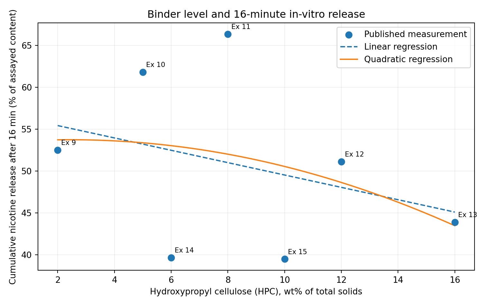
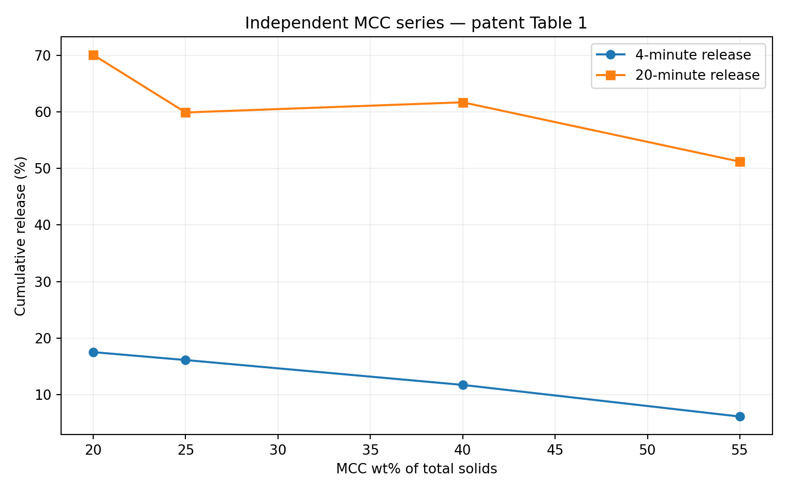

# Oral Pouch Materials: Public-Data Quality Modeling and DOE

**Independent reproducible research portfolio | materials characterization, formulation science, and statistical analysis**

This project reanalyzes publicly reported experimental data to study the relationships among tapped bulk density, estimated powder-bed porosity, flowability, moisture, and formulation-dependent in-vitro release profiles.

> **No proprietary or employer data.** Published summary data only. No original laboratory measurements are claimed.

## New: independent factorial reanalysis (secondary analysis)

The original patent data were collected by the patent applicant, **not** by this project. This repository now performs an independent arithmetic factorial reanalysis of eight reported formulations, computes release-profile summaries, and compares two explicitly exploratory reduced prediction models. It does **not** establish a quality optimum.

**[Read the factorial analysis and limitations](reports/factorial_study.md)** · **[See computed effects](data/factorial_effects_by_time.csv)** · **[Compare models](data/model_comparison_30min.csv)**

### Observed 30-minute release: all eight categorical conditions



### Factorial contrasts over time


### Exploratory out-of-sample prediction check



**Note:** A continuous contour or response surface is **not appropriate** for three two-level categorical factors. The colored heatmap displays only combinations actually measured in the patent. Eight unreplicated runs cannot establish a statistically validated optimum. Published formulations also differ in some ingredients outside the three simplified factor labels; the report explicitly discusses this confounding.

**Run the new study** after installing requirements:

```powershell
python scripts/factorial_study.py
```

## Research questions

1. How do tapped-bed porosity and oven volatiles vary across seven commercial oral nicotine pouch fillers?
2. What are the *descriptive* main and interaction effects of premix category, sodium alginate presence, and calcium chloride presence on 30-minute release in eight publicly reported patent formulations?
3. Which hypotheses warrant prospective replicated experiments before a product-quality improvement can be claimed?

## Project layout

```text
oral-pouch-materials-quality-modeling/
├── README.md
├── requirements.txt
├── data/
│   ├── SOURCES.md
│   ├── physical_properties_table6.csv
│   ├── moisture_table8.csv
│   └── patent_table22_release.csv
├── scripts/
│   ├── analyze.py
│   └── factorial_study.py
├── tests/
│   └── test_data.py
├── reports/
│   ├── results.md        (generated)
│   └── factorial_study.md
└── figures/              (generated PNGs)
```

## Run on Windows (Python 3.9+)

From the project directory in PowerShell:

```powershell
py -m venv .venv
.\.venv\Scripts\Activate.ps1
python -m pip install -r requirements.txt
python -m unittest discover -s tests
python scripts/analyze.py
python scripts/factorial_study.py
```

Open the `figures` directory for the charts and `reports/results.md` for calculated results. If PowerShell blocks activation, run `.venv\Scripts\python.exe` directly instead of activating.

## Data and methods

**Study A (observational):** Seven commercial products reported in Platt et al., *Scientific Reports* (2026). Reported void fraction is defined as `100 × (1 − tapped bulk density / true density)`. This refers to the *packed powder bed*, not nanometer-scale pores inside MCC particles. Density-derived quantities (Carr index, Hausner ratio, and porosity) are algebraically related to input densities; do not enter all of them as independent causal predictors.

**Study B (formulation comparisons):** Eight patent examples in US20260232007A1, Table 22. The analysis codes premix II/VI, alginate absence/presence, and CaCl2 absence/presence as -1/+1. For each factor and interaction, the script calculates the difference in mean 30-minute release at the +1 and -1 levels. These are descriptive factorial contrasts, **not** significance-tested effects.

The studies are distinct and **must not be merged into a single factorial model**.

## Interpretation safeguards

- Seven product-level averages are too few to validate a multivariable predictive quality model.
- The eight patent runs have no cell-level replicates, leaving no pure-error estimate in a fully saturated 2³ model.
- Some patent formulation ingredients co-vary with the coded factors (e.g., xylitol, purified water, NaCl); this limits causal attribution.
- Higher release at 30 min is *not* automatically higher quality. Target performance specifications, stability, sensory properties, and safety are not jointly available here.
- These analyses generate hypotheses for **future, separately validated** experiments rather than claiming an optimized formulation.

## Reproducibility / attribution

See [`data/SOURCES.md`](data/SOURCES.md) for each primary source, the precise original tables, and caveats. Published numerical results are identified separately from our calculations. The scripts and report are original and can be reused with attribution. Check the original publication's license for reuse of source data; patents can still carry enforceable rights.

## Planned expansions

- Extract source-verified, numerical dissolution endpoints from the peer-reviewed study to compare with material properties.
- Add replication, uncertainty, and prospective formulation DOE when independent experimental data become available.
- Create literature-grounded, multiobjective quality specifications rather than maximizing one release endpoint.


---

## Stage 2 — Continuous-factor public-data reanalysis (2025 patent)

We independently transcribed Tables 1, 4 and 5 of [US20250072472A1](https://patents.google.com/patent/US20250072472A1/en) and investigated **seven hydroxypropyl-cellulose binder levels** and a **separate four-level MCC comparison**. These are independent secondary analyses; no experiments were conducted for this repository.

[Read the continuous-factor analysis](reports/continuous_factor_study.md) · [View model comparison CSV](data/hpc_model_comparison.csv) · [Source binder dataset](data/hpc_binder_patent_table4_table5.csv)

### Observed binder-level trend and exploratory regression




### Other physical properties


### Separate MCC study



### Actual measured binder levels by measurement time — NOT a two-factor RSM


**Scientific limits:** Published patent-applicant results are unreplicated, and some outcomes and covariates (including pH) differ across runs. HPC binder and MCC were *not* studied jointly as a crossed factorial design. This is not evidence for a validated optimum; no invented 3D contour or response surface is shown. The [prospective DOE template](data/prospective_two_factor_design_TEMPLATE_NOT_RESULTS.csv) contains blank response cells for potential future laboratory work.

Run locally: `python scripts/continuous_factor_study.py`.
