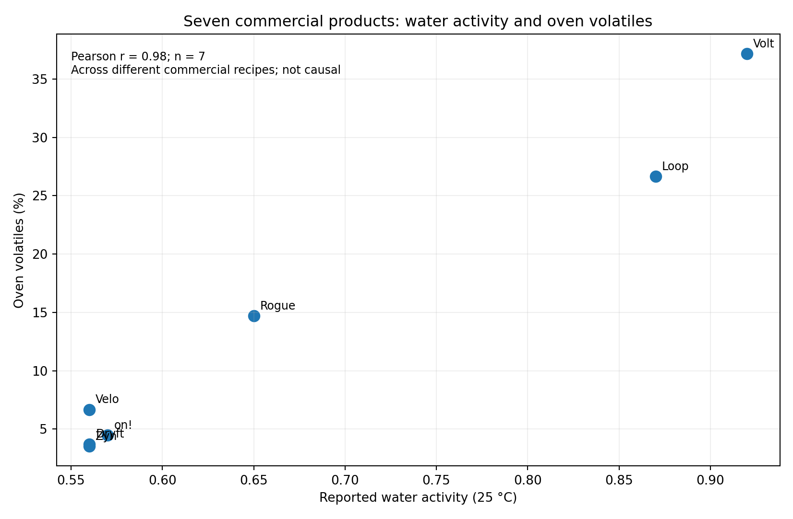
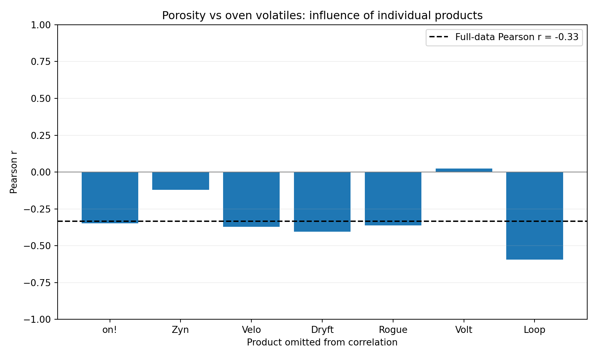
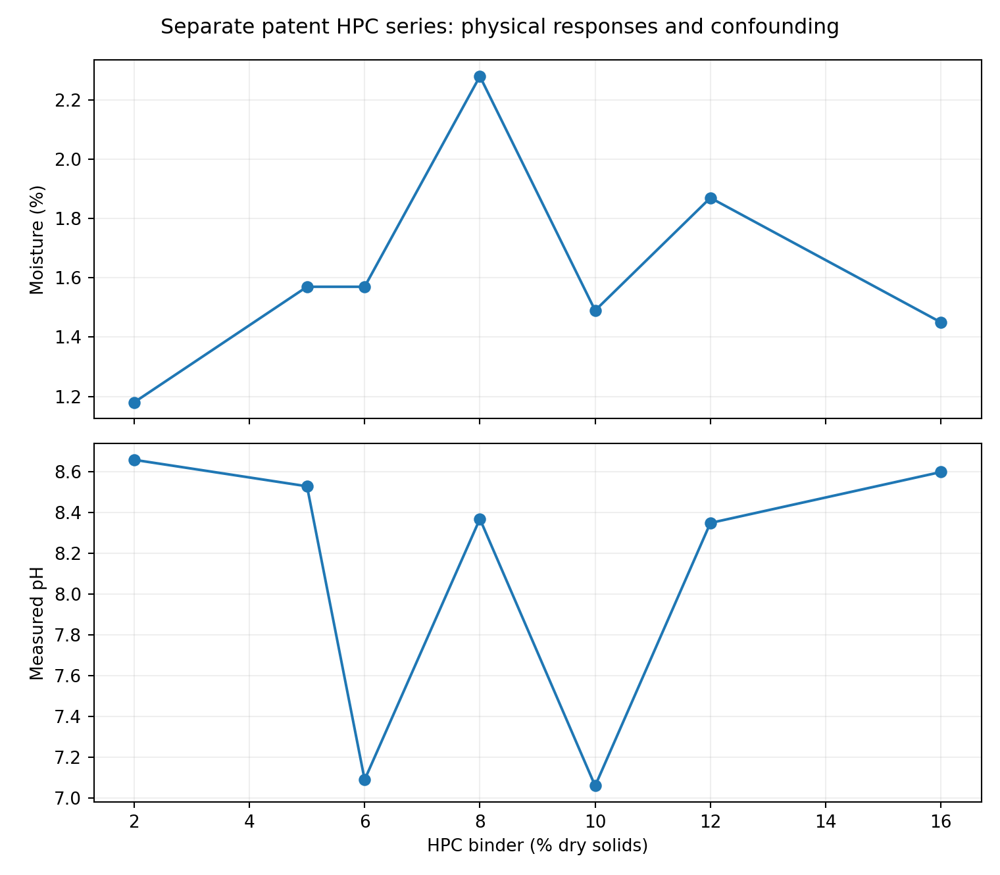

# Stage 3 — Material-quality evidence and prospective experimental design

**Scope:** Independent analysis of published summary measurements, plus a PROPOSED non-nicotine material DOE. No original experiments and no validated product-quality optimum.

## Quantitative findings

Commercial-product data: 7 products (2026 *Scientific Reports*). The Pearson correlation between reported water activity and oven volatiles is **0.983** (descriptive only). Reported tapped-bed porosity and oven volatiles have Pearson **r = -0.333**. Removal of one product at a time changes that last coefficient from **-0.595 to 0.023**, demonstrating sensitivity to the small heterogeneous sample. These correlations are not independent grade-controlled observations, and oven volatiles need not be chemically specific to water.

Patent binder-series data: **7 distinct HPC levels**. Both moisture and pH change across reported formulations, so any relation between HPC content and measured release is confounded; neither an optimal HPC fraction nor an HPC×MCC interaction can be estimated from this independent single-factor series.

See [`data/stage3_associations_and_sensitivity.csv`](../data/stage3_associations_and_sensitivity.csv) for all reported associations and leave-one-out ranges. Correlations are exploratory and are not hypothesis tests. With these sample sizes, avoid asserting population predictions.

## New external public dataset located (not automatically incorporated)

Ibrahim and Markl (2025), University of Strathclyde: [Dataset DOI 10.15129/e9a284a2-8954-463e-9fed-06b5b1893c82](https://doi.org/10.15129/e9a284a2-8954-463e-9fed-06b5b1893c82). The deposited dataset is **115 MB**, **CC BY 4.0**, and includes DVS adsorption/desorption Excel datasets and particle-size results for MCC, croscarmellose sodium and sodium starch glycolate. **The raw 115-MB data are not bundled with this repo and are not analyzed by this script.** Download from its publisher and verify metadata before reanalysis. This is an excipient data resource, not pouch formulation response data.

Related 2025 literature: [Serajuddin et al., *Moisture sorption and desorption of different commercially available MCC grades as a function of relative humidity*](https://doi.org/10.66617/001c.141261). The article can guide future controlled grade comparisons, but its graphs are not digitized or treated as raw data here.

## Prospective RSM-ready design — not experimental results

`data/stage3_prospective_non_nicotine_DOE_BLANK.csv` has **81 independently prepared runs**, randomized within a three-grade-block × three-HPC-level × three-RH-level × triplicate plan.

- Fixed factors: MCC grade (three selected materials; labels are placeholders).
- Numeric factors: **HPC 2, 9, 16% of dry solids** and conditioning **RH 33, 55, 75%**, at a fixed specified temperature. These are illustrative factor levels, not optimized or directly prescribed pouch formulations.
- Hold powder mass, non-HPC components, preprocessing, conditioning time/criterion, analytical methods, and material lot policy constant. When HPC varies, replace an explicitly specified inert carrier so dry mass sums to 100%. Do not infer a commercial recipe from this template.
- Proposed responses: equilibrated moisture (%) by gravimetry or validated Karl Fischer; DVS hysteresis (define statistic in advance); powder cohesion (validated method); particle size (validated method).
- The response columns are **blank**. If empirical data become available, a model including numeric linear, curvature, HPC×RH interaction and MCC-grade effects can be tested, with residual and lack-of-fit diagnostics and replicate-based uncertainty. Do not fit a response surface to unmeasured values.

## Decision gate for quality improvement

A material-quality recommendation requires: (1) a predeclared quality specification, (2) crossed experiments or appropriate public crossed-factor data, (3) replication and independent validation, (4) measured trade-offs in moisture management and physical integrity, (5) assessment of whether results transfer to pouch applications. **No best commercial formulation is claimed.**

## Figures

