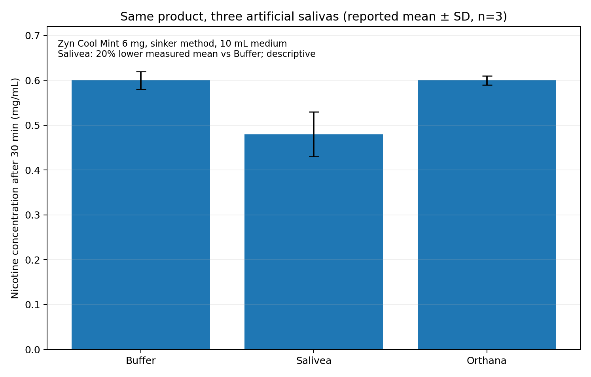
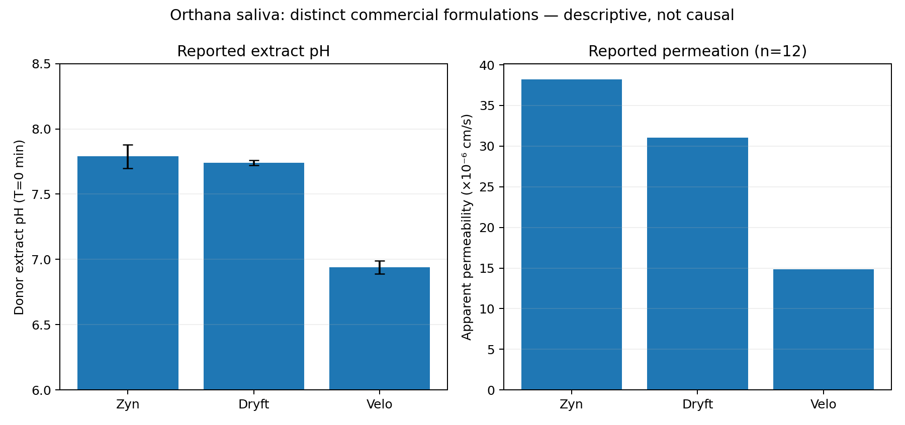
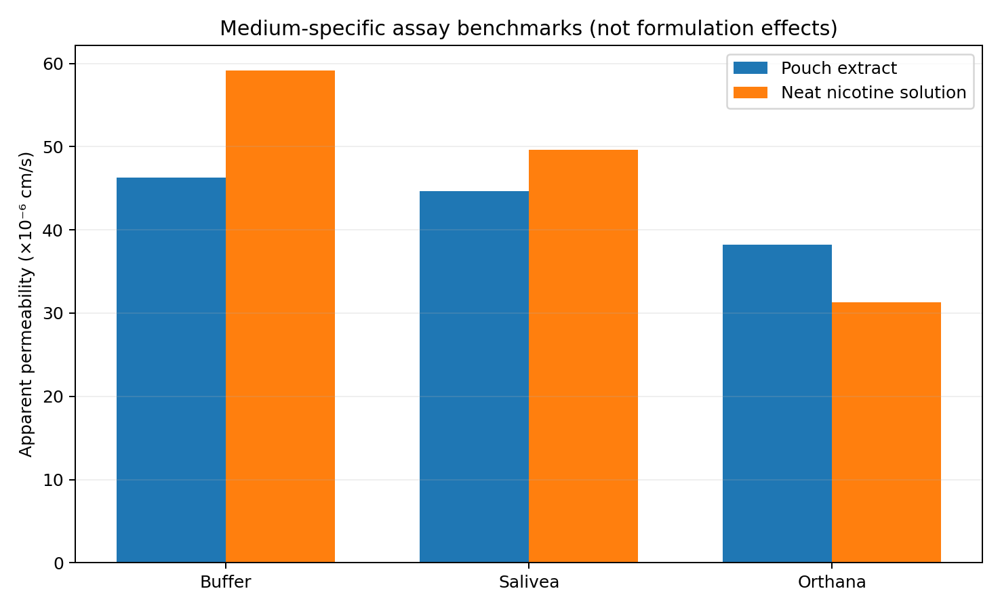

# Stage 4 — Environmental robustness and evidence for predictive quality models

**Independent secondary analysis; no proprietary data, no new laboratory experiments.** The 2025 ACS Omega paper provides *published aggregated* concentration, pH and apparent permeability measurements. Its CC-BY-NC-ND license is restrictive; these files record individually cited numerical observations for research with attribution, not the paper's illustrations or full text. Check conditions before redistribution/commercial reuse.

## New, actually observed sensitivity

Zyn Cool Mint 6 mg tested via the same **30 min, 10 mL sinker method** had reported concentrations of **0.60 mg/mL (Buffer), 0.48 mg/mL (Salivea), and 0.60 mg/mL (Orthana)** (n = 3 summaries). Salivea was **-20.0%** lower than Buffer for this measured endpoint. The study also reported pH and ex-vivo permeability results that vary by medium and formulation. These represent **distinct assays** and are not raw paired observations. Do not treat the product rows as independent replicates or infer statistical significance from the percentage.

## Distinguishing product formulation from test environment

In Orthana the paper reported different extract pH and apparent permeability for Zyn, Dryft and Velo. Brand identity, dose, flavor and matrix vary together, so these differences do **not** isolate the effect of any material ingredient. Avoid fitting a continuous regression from these **three** brand-level observations.

The published neat-nicotine control experiment held nicotine concentration (0.5 mg/mL) and solution pH (8.5) constant while varying the artificial saliva. This establishes that *measurement medium* affects apparent permeability in this in-vitro/ex-vivo context. These controls are **not** additional formulation runs and must not be pooled with pouch extracts.

## Engineering implications for future cellulose-based pouch materials work

1. Treat *measurement environment* (saliva type, buffer capacity, volume, mixing, test time) as part of the experimental protocol and model metadata, never assume an effect is formulation-caused.
2. Predeclare material-focused critical quality attributes: equilibrium moisture, water activity, particle-size variation, batch homogeneity, cohesion, and aging stability.
3. For an **MCC/HPC non-nicotine reference-material DOE**, cross binder fraction with RH and MCC grade; monitor DVS hysteresis and physical integrity using a *consistent* protocol. This design requires new measured results before a response surface can be fitted.
4. Interpret moisture and particle-size evidence separately from biological permeability; biological release and absorption are not proxy quality targets.
5. If future data permit external validation, partition by **source study, batch, and product** rather than by individual time points or repeated readings. Product names shared across papers do not establish matching SKU or comparability.

## What the new data cannot prove

- No empirically established optimum MCC/HPC composition.
- No validated cross-study pore-volume-to-release predictive model.
- No causal quality ranking of commercial brands.
- No justified 3D HPC×MCC response surface, because the studies are not a crossed factorial design.

## Reproducibility and provenance

- Original: Xia Li et al., *ACS Omega* (2025), DOI [10.1021/acsomega.5c06007](https://doi.org/10.1021/acsomega.5c06007), Tables 1–3 and §§3.4.3–3.4.4.
- `data/stage4_artificial_saliva_observations.csv`: five rows; Tables 2–3 and the reported Papp values. The 30-min concentrations were reported with n=3; pH and permeability used different experimental measurements; avoid row-level paired inference.
- `data/stage4_product_assay_summary.csv`: Table 1 n=3.
- `data/stage4_neat_solution_saliva_benchmark.csv`: section 3.4.3 controls with constant 0.5 mg/mL and pH 8.5.
- `data/stage4_public_data_feature_inventory.csv`: sources, permissible interpretation, and missing variables. The Strathclyde raw DVS archive remains external, unprocessed.
- Scripts regenerate the three original figures and derived summary tables from manually transcribed, source-attributed values.
