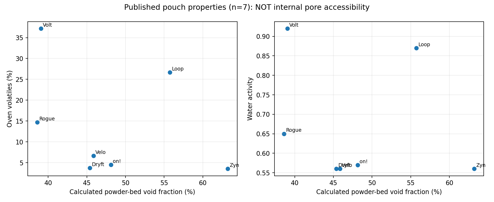
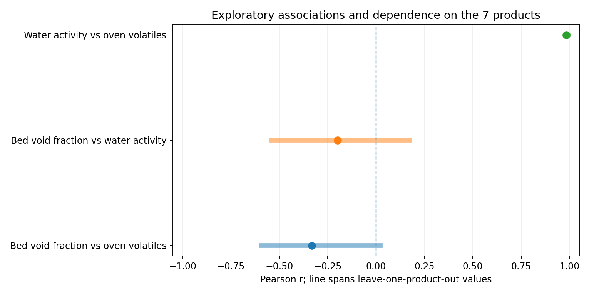
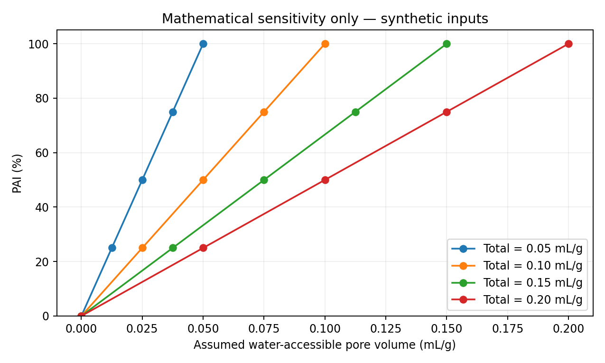

# Stage 9 — Pore Accessibility Index: Methods, Existing Data, and Validation Gap

**Status:** Mathematical framework and secondary-data reanalysis completed. **No measured PAI for commercial products.**

## Research question

Can water-accessible internal pore volume explain MCC hydration/transport beyond conventional powder-bed porosity? This hypothesis is not testable directly with the seven-product dataset because matched internal pore volumes were not reported.

## Operational definitions

For a specified material, specimen hydration state, temperature and pore-size interval, the **operational pore accessibility index** is

\[\mathrm{PAI}(\%)=100\frac{V_{\mathrm{water\text{-}accessible}}}{V_{\mathrm{total\ pores}}}.\]

Both quantities (mL/g dry solids) must refer to an **identical pore population and material state**. Accessibility is probe-specific, measurement-protocol-specific, and potentially RH/time-dependent. A derived number from unmatched methods is not an empirical PAI.

- **Numerator:** independently measured *water-accessible internal* pore volume over specified pore sizes. Depending on the method, a calibrated water-probe method may estimate accessible pore water; DSC thermoporometry usually measures **freezable confined water only** and cannot automatically count nonfreezing water. DVS mass gain reflects adsorption, swelling, and other water uptake, not pure pore filling.
- **Denominator:** independently established total internal pore volume over the same domain for the **same material state**. A possible operational proxy is `1/envelope_density - 1/skeletal_density` (mL/g), but only after confirming envelope volume excludes interparticle voids and density methods probe the intended pores. Dry helium pycnometry versus a swollen wet specimen is **not** a matched ratio.
- Pore accessibility is not equivalent to open-pore connectivity, transport tortuosity, or pore-size distribution. Each requires separate testing.

## What the existing research actually measures

The **Scientific Reports 2026** paper (Platt et al., https://doi.org/10.1038/s41598-025-34556-5, Table 6 / Table 8) reports **tapped bulk density, true density, calculated tapped-bed porosity, oven volatiles, and water activity** for seven commercial formulations. None of these supply a measured internal water-accessible pore volume. Tapped density includes interparticle spaces; its void-fraction estimate cannot be used as `V_total internal pores`.

Stage 9 reuses source-transcribed `data/physical_moisture_combined.csv`, recomputes exploratory Pearson associations, and tests each association's sensitivity to removing one product. **These are cross-product descriptive relationships; no causal inference or pouch-quality ranking follows.**

See [calculated associations](../data/stage9_published_associations.csv). Density-derived porosity is algebraically dependent on tapped and true density; do not include all three as independent regressors without checking multicollinearity. Oven volatiles at 80 °C are not equivalent to a water-specific assay.

## Transparent calculation utility

`calculate_pai()` in [the Stage 9 Python script](../scripts/stage9_pore_accessibility.py) enforces:

1. Nonnegative, finite volume values, `V_total > 0`, and `V_accessible <= V_total`.
2. Explicit confirmation of a common pore-size interval, common hydration/material state, and compatible methodology.
3. No scoring when either pore volume is unavailable; no synthetic substitution or arbitrary caps.

A blank experimental input sheet is supplied: [PAI measurement template](../data/stage9_PAI_measurement_TEMPLATE_BLANK.csv). Run `python scripts/stage9_pore_accessibility.py --measurement-csv data/stage9_PAI_measurement_TEMPLATE_BLANK.csv` to see that missing values are *not calculated*.

### Sensitivity illustration — not measurements

[Hypothetical illustration CSV](../data/stage9_HYPOTHETICAL_pai_sensitivity_NOT_RESULTS.csv) is explicitly synthetic. It cannot support brand comparisons or a structure–property conclusion.

## Prospective validation protocol (nicotine-free MCC/HPC materials)

Select independently sourced MCC grades, hold specimen mass and processing constant, equilibrate at documented RH and temperature, and measure hydration/sorption separately from internal pore geometry. For example:

1. Determine RH-dependent DVS sorption and desorption hysteresis with sufficient equilibrium criteria and replicates.
2. Estimate confined-freezable water and pore-size windows by *calibrated* DSC thermoporometry and document nonfreezing-water limitations.
3. Establish total internal pore volume using an appropriate independent method with matched hydrated geometry/pore domain; record swelling and sample preparation artifacts.
4. Obtain physical responses (wetting kinetics, cohesion, retention of shape), with replicate-level uncertainty and full measurement uncertainty.
5. Validate association between operational PAI and each response independently, using out-of-sample samples/grades and confidence intervals.

**Do not compute a single PAI when dry total-pore measurements are divided into wet-state confined water.** That ratio may be documented separately as an *apparent cross-method index* with qualified meaning, but not an accessibility percentage.

## Data availability, limitations, and conclusion

The present commercial-pouch dataset supports tapped-bed void fraction, not internal pore accessibility. Stage 9 contributes (i) a falsifiable operational index, (ii) robust input-quality rules, (iii) transparent correlations, (iv) an explicit measurement gap, and (v) a validation strategy. No claim is made that a high PAI is always desirable, that one brand has greater PAI, or that PAI predicts nicotine release using the currently available data.

### References

1. Platt, S. P. et al., *Dissolution and physical characterization of oral nicotine pouch products*, **Scientific Reports** 16, 4406 (2026). https://doi.org/10.1038/s41598-025-34556-5
2. *Dynamic vapor sorption and thermoporometry to probe water in celluloses*, **Cellulose** (2012). https://doi.org/10.1007/s10570-012-9727-z
3. *A method to evaluate biomass accessibility in wet state based on thermoporometry*. https://pubmed.ncbi.nlm.nih.gov/22843391/
